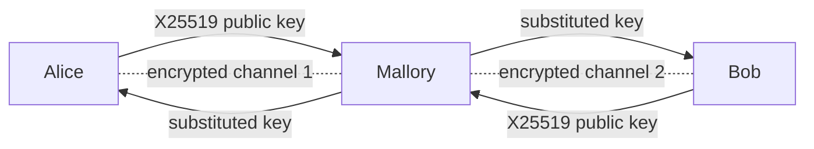

# Authenticated Diffie–Hellman MITM Simulator

> A hands-on Cryptography and Network Security mini project that shows why encryption alone is not enough—and how digital signatures stop a man-in-the-middle attack.

[](https://www.python.org/)
[](https://streamlit.io/)
[](#testing)
[](#security-scope)

## The idea in one minute

Alice wants to send a private message to Bob. Diffie–Hellman lets them create the same secret key without sending that key across the network. The message can then be encrypted with AES-GCM.

There is still a problem: ordinary Diffie–Hellman does not prove who supplied a public key. Mallory can stand between Alice and Bob, replace both public keys, and build two separate encrypted connections. Alice and Bob see encryption working, but Mallory can read and change the message.

This project runs that exact attack and then repeats it with **Ed25519 signatures**. Once the temporary Diffie–Hellman keys are signed, Mallory can no longer replace them without being detected.



## What the experiment proves

| Case | What happens | Result |
|---|---|---|
| Normal exchange | Alice and Bob derive the same key and exchange an encrypted message. | Confidential against passive observers, but not authenticated. |
| MITM attack | Mallory replaces both public keys, decrypts Alice's message, changes it, and re-encrypts it for Bob. | Attack succeeds. |
| Authenticated defense | Alice and Bob sign their temporary X25519 keys using Ed25519 identity keys. | Mallory's substituted key fails signature verification. |

The important lesson is simple:

> **Encryption protects the contents of a message. Authentication proves who is on the other end. A secure channel needs both.**

## Cryptography used

| Primitive | Role in the project |
|---|---|
| **X25519** | Creates a shared secret between two participants. |
| **Ed25519** | Signs temporary public keys and verifies their owner. |
| **HKDF-SHA-256** | Converts the X25519 shared secret into a 256-bit session key. |
| **AES-256-GCM** | Encrypts the message and detects ciphertext tampering. |
| **SHA-256** | Produces safe fingerprints and privacy-preserving audit digests. |

The project uses the implementations supplied by Python's `cryptography` package. It does not attempt to create custom cryptographic algorithms.

## Application tour

The Streamlit interface has four focused sections:

- **Project overview** — introduces the question and runs all three scenarios side by side.
- **Live demonstration** — lets you change Alice's message and Mallory's attempted replacement.
- **Experiment log** — stores privacy-safe observations, supports CSV export, and compares timing.
- **Key exchange playground** — uses deliberately small numbers so the Diffie–Hellman calculation can be followed by hand.

Light and dark themes are included. Every simulation also produces a readable protocol transcript showing the actor, operation, detail, and security state at each step.

## Quick start

### 1. Clone the repository

```bash
git clone https://github.com/purpoint/authenticated-diffie-hellman-mitm-simulator.git
cd authenticated-diffie-hellman-mitm-simulator
```

### 2. Create a virtual environment

```bash
python3 -m venv .venv
source .venv/bin/activate
```

On Windows PowerShell, activate it with:

```powershell
.venv\Scripts\Activate.ps1
```

### 3. Install and run

```bash
python -m pip install -r requirements.txt
streamlit run app.py
```

Open the address printed by Streamlit, normally [http://localhost:8501](http://localhost:8501).

## A good demonstration sequence

1. Open **Live demonstration** and choose **Normal exchange**.
2. Enter a message and run the simulation. Alice and Bob should have matching key fingerprints.
3. Choose **MITM attack**, enter Mallory's replacement, and run it again. Bob receives the changed message.
4. Choose **Authenticated defense** and try the same replacement. Bob receives Alice's original message because the substituted key is rejected.
5. Expand **Technical details and protocol transcript** to explain exactly where the attack succeeds or fails.
6. Use **Experiment log** to run repeated trials and export the observations for the project report.

## Command-line use

The same scenarios are available without the web interface.

```bash
# Guided demonstration
python main.py --demo

# Individual scenarios
python main.py --scenario normal --message "The meeting is at 10:00 AM"
python main.py --scenario mitm --message "Pay Bob" --replacement "Pay Mallory"
python main.py --scenario protected --message "Pay Bob" --replacement "Pay Mallory"

# Audit history and timing experiment
python main.py --history
python main.py --benchmark 50
```

## Project architecture

```text
Streamlit UI / CLI
        |
        v
Simulation Service --------> SQLite Audit Database
        |                    (digest and metadata only)
        v
Protocol Engine
  |- X25519 key exchange
  |- Ed25519 signatures
  |- HKDF-SHA-256
  `- AES-256-GCM
```

```text
.
├── app.py                       # Streamlit interface
├── main.py                      # Command-line interface
├── simulation_service.py        # Scenario orchestration, timing and auditing
├── audit_database.py            # SQLite audit persistence
├── report_generator.py          # Evidence and CSV exports
├── demo_walkthrough.py          # Guided classroom demonstration
├── crypto_simulator/
│   └── protocol.py              # Cryptographic operations and scenarios
├── docs/
│   ├── ARCHITECTURE.md          # Design and methodology
│   ├── PROJECT_REPORT.md        # Ready-to-study project report
│   └── VIVA_GUIDE.md            # Viva questions and concise answers
└── tests/                        # Automated test suite
```

## Testing

Install the development requirements and run the complete suite:

```bash
python -m pip install -r requirements-dev.txt
pytest -q
```

The **23 automated tests** cover key agreement, AES-GCM delivery, successful MITM substitution, signature-based rejection, invalid inputs, audit privacy, reports, benchmarks, themes, and Streamlit flows.

## Documentation

- [Architecture and methodology](docs/ARCHITECTURE.md)
- [Mini-project report](docs/PROJECT_REPORT.md)
- [Viva preparation guide](docs/VIVA_GUIDE.md)

## Privacy choices

The audit database never stores Alice's plaintext message. It records only a SHA-256 digest, scenario, duration, result, and non-secret metadata. Private keys, raw shared secrets, and session keys stay in memory and are never displayed or persisted.

## Security scope

This is an educational simulator, not a production messaging system. Identity keys are generated in memory for each run, and prior trust between Alice and Bob is simulated. A real system would also need certificate or key-distribution infrastructure, secure long-term key storage, replay protection, protocol negotiation, operational monitoring, and an independent security review.

## References

- [RFC 7748 — Elliptic Curves for Security](https://www.rfc-editor.org/rfc/rfc7748) (X25519)
- [RFC 8032 — Edwards-Curve Digital Signature Algorithm](https://www.rfc-editor.org/rfc/rfc8032) (Ed25519)
- [RFC 5869 — HMAC-based Extract-and-Expand Key Derivation Function](https://www.rfc-editor.org/rfc/rfc5869) (HKDF)
- [NIST SP 800-38D — Galois/Counter Mode](https://csrc.nist.gov/pubs/sp/800/38/d/final) (AES-GCM)

---

Built as a BCS703 Cryptography and Network Security mini project.
